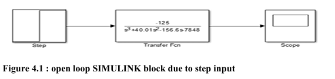
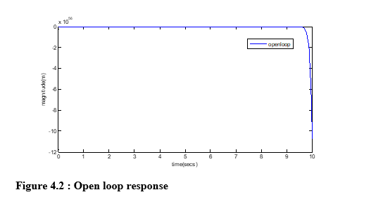
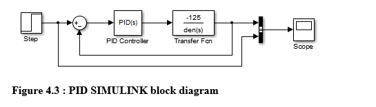
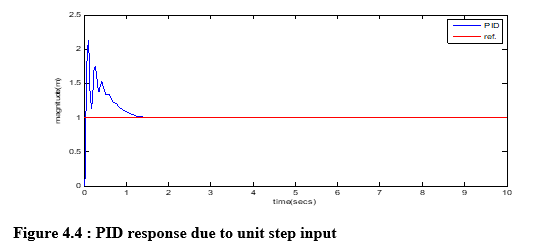
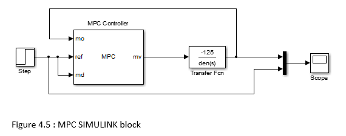
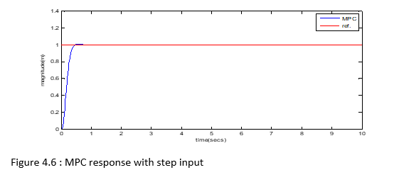

# Project 01: Design of a Model Predictive Controller for a Magnetic Suspension System

**Project period:** 2016–2017  
**Degree:** B.Eng. Electrical Engineering  
**Institution:** Kano University of Science and Technology, Wudil, Nigeria  
**Software:** MATLAB and Simulink  
**Methods:** Mathematical modelling, Jacobian linearisation, PID control, Model Predictive Control (MPC)

## Project summary

This undergraduate project studied the modelling and simulation-based control of a magnetic suspension system. The system is open-loop unstable, so feedback control is required to regulate the position of the suspended object.

The project developed a linearised state-space representation and used MATLAB/Simulink to investigate two feedback-control approaches: a conventional PID controller and a Model Predictive Controller. Their time-domain responses were compared using rise time, settling time, peak time and maximum overshoot.

## Problem addressed

The position of a magnetically suspended object must be regulated by adjusting the voltage applied to an electromagnet. The open-loop system is unstable around the operating point. The project investigated whether MPC could improve the closed-loop response compared with the PID controller used as a baseline.

## Mathematical model reported in the thesis

The thesis reports the following linearised state-space matrices:

\[
A = \begin{bmatrix}
0 & 1 & 0\\
196.2 & -0.01 & -3.1312\\
0 & 12.5284 & -40
\end{bmatrix},\quad
B = \begin{bmatrix}0\\0\\40\end{bmatrix}
\]

\[
C = \begin{bmatrix}1 & 0 & 0\end{bmatrix},\quad D=0
\]

The transfer function reported in the thesis is:

\[
G(s)=\frac{-125.3}{s^3+40.01s^2-156.6s-7848}
\]

The state variables represent position, velocity and coil current, while the input is the applied voltage and the output is position.

## Controller settings reported in the thesis

### PID

The PID tuning table in the scanned thesis reads:

| Parameter | Printed value |
|---|---:|
| Proportional | `-152kj` |
| Integral | `-190` |
| Derivative | `-16` |

The proportional entry appears to contain a typographical or formatting error. It is **not silently corrected here**. The value `-152` has been suggested as a likely intended value, but it must be checked against the original source or supervisor's records before being treated as confirmed.

### MPC

| Parameter | Value |
|---|---:|
| Prediction horizon | 29 |
| Control horizon | 4 |
| Sampling time | 0.0064 s |

## Results reported in the original thesis

| Performance measure | PID | MPC |
|---|---:|---:|
| Rise time (s) | 0.0284 | 0.2374 |
| Settling time (s) | 1.2646 | 0.4051 |
| Peak time (s) | 0.0925 | 0.5568 |
| Maximum overshoot (%) | 74.300 | 0.5519 |

### Interpretation

The thesis reports that PID had the faster rise time and peak time. MPC had the shorter settling time and substantially lower maximum overshoot. These are the values reported by the original undergraduate thesis; they have not been independently reproduced or re-measured as part of this documentation package.

## Original implementation and available files

The original thesis describes a MATLAB/Simulink block-based implementation. The PDF includes the reported open-loop, PID and MPC Simulink diagrams and response plots.

The original `.slx` source models have not yet been supplied as separate files. The `Simulink_Models` folder is therefore intentionally empty until the original models or verified reconstructions are added.

## Reproducibility and provenance

This repository separates three types of material:

1. **Original thesis material:** the submitted 2017 PDF and results transcribed from it.
2. **Reconstruction material:** any new Simulink models created later to understand or reproduce the work.
3. **New experiments:** any later controller tuning, simulations or measurements.

New results must be labelled with their date, model assumptions and controller settings. They must not be presented as results from the 2017 thesis.

## Repository contents

- `Thesis/Original_Bachelor_Thesis.pdf` — original undergraduate thesis.
- `Documentation/Technical_Notes.md` — technical summary and transcription notes.
- `Results/README.md` — index for original figures and future result exports.
- `Simulink_Models/README.md` — status of original and reconstructed Simulink files.

## Skills demonstrated

- Nonlinear-system modelling and linearisation
- State-space and transfer-function representation
- Feedback control
- PID controller implementation
- Model Predictive Control
- MATLAB/Simulink simulation
- Time-domain response analysis
- Technical documentation
## 7. Original Simulink Models and Response Plots

The following figures are taken from my original 2017 undergraduate thesis. They show the Simulink implementation and step-response performance of the open-loop system, PID controller and Model Predictive Controller (MPC).

### 7.1 Open-loop system

### 7.2 PID controller

### 7.3 Model Predictive Controller

*Source: Original undergraduate thesis, 2017.*
