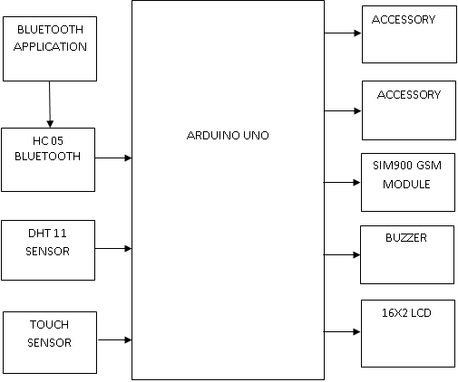
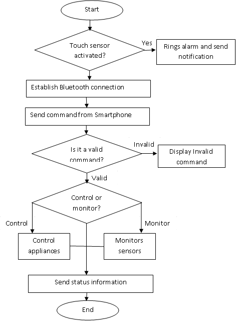
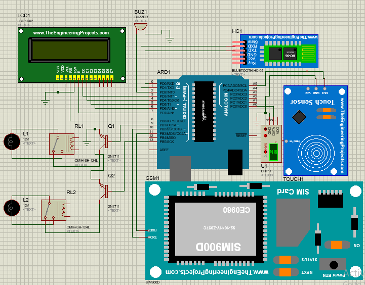
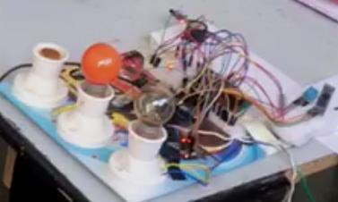
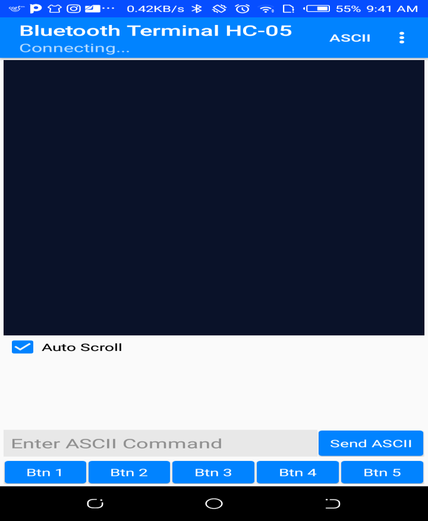

# Project 06: Design and Implementation of a Smart Home (Arduino, Bluetooth, GSM)

**Project period:** session 2020-2021   
**Degree:** M.Tech, Robotics and Embedded Systems  
**Institution:** Mewar University, Chittorgarh, India (Department of Electronics and Communication Engineering)  
**Supervisor:** Mr. Ritesh Ojah  
**Software:** Arduino IDE (C++), Proteus 8 (circuit simulation)  
**Hardware:** Arduino Uno (ATmega328P), HC-05 Bluetooth module, SIM900 GSM module, DHT11 sensor, touch sensor (TTP223), 16x2 LCD, relay modules, buzzer

## Project summary

A hardware prototype of a small home-automation system. From a smartphone, over Bluetooth, the user can switch two lamps and show temperature and humidity on an LCD. A touch sensor acts as an intruder alarm: when it is triggered, the system rings a buzzer and sends an SMS through a GSM module.

The system works locally only. It has no internet connection, and the dissertation states a use range of about 10 m.

## Problem addressed

Home-automation systems that need internet access are more expensive and more complex to set up. The dissertation builds a simple, low-cost local system with Bluetooth, aimed in particular at elderly and disabled people who find it hard to move around to operate appliances.

## System architecture

An Arduino Uno is the controller. The HC-05 module receives commands from a free Android Bluetooth terminal app. **The app is an existing app, not one I wrote.** The Arduino drives the lamps through relay modules, shows messages and the weather readout on the LCD, and sounds the buzzer. The SIM900 sends the SMS.

## Pin assignments

From the printed sketch (Section 5.4 of the dissertation) unless noted.

| Function | Arduino connection |
|---|---|
| HC-05 Bluetooth | Hardware serial (pins 0 and 1), 9600 baud |
| 16x2 LCD | `LiquidCrystal lcd(8,7,3,4,5,6)`: RS = 8, EN = 7, data = 3, 4, 5, 6 |
| First lamp (relay) | Pin 9 |
| Second lamp (relay) | Pin 13 |
| Buzzer | Pin 2 |
| Touch sensor | A5 (read with `analogRead`) |
| DHT11 | A0  |
| SIM900 | `SoftwareSerial mySerial(10, 11)`: the Arduino receives on pin 10 and transmits on pin 11, so the module's TX goes to pin 10 and its RX to pin 11 |

## Commands

Single ASCII characters are sent from the phone.

| Action | Character |
|---|---|
| First lamp on | `1` |
| First lamp off | `2` |
| Second lamp on | `3` |
| Second lamp off | `4` |
| Show temperature and humidity | `0` |

## Development and testing

1. The circuit was drawn and simulated in Proteus 8 to check connections and the program.
2. It was then tested on a breadboard.
3. The final system was built on a vero board.

Testing, as described in the dissertation:

- **Static tests** (power off): visual inspection of connections, ohmmeter continuity checks and a polarity check.
- **Dynamic tests** (powered): supply voltage and current into and out of the Arduino measured with a multimeter, and end-to-end tests by sending commands from the phone over Bluetooth.

The dissertation reports that the system worked as intended. **It gives no quantitative results** (no latency, range or reliability measurements).

## Limitations

- Controls only a few appliances because of the limited input/output pins of the Arduino Uno.
- Short-range Bluetooth: the stated scope is use within about 10 m. I did not measure the range.
- No internet or remote control. The dissertation suggests an internet-enabled module (NodeMCU) as future work.
- Functional tests only, with no measured performance figures.
- Built from ready-made modules and an existing phone app.

## Reproducibility and provenance

This repository separates three kinds of material:

1. **Original dissertation material:** the PDF in `Thesis/`, and the figures in `Results/`, which are taken from it and named after their figure numbers in the dissertation.
2. **Transcribed code:** `Firmware/as_printed/` is the sketch exactly as printed in the dissertation appendix. `Firmware/corrected/` fixes only the two compile errors in it.
3. **New material:** none yet. Anything added later must be labelled with its date and assumptions, and must not be presented as part of the original dissertation.

The SMS phone number is redacted in the dissertation. Use your own number.

## Repository contents

- `Thesis/Original_Master_Thesis.pdf`: the dissertation (67 pages).
- `Firmware/as_printed/smart_home_as_printed.ino`: sketch as printed.
- `Firmware/corrected/smart_home.ino`: sketch with the two compile errors fixed.
- `Documentation/Technical_Notes.md`: wiring, transcription notes and how the differences were resolved.
- `Results/`: figures from the dissertation (block diagram, flowchart, Proteus circuit, prototype photo, phone app).

## Skills demonstrated

- Microcontroller programming in Arduino C++
- Serial communication (UART, SoftwareSerial) and AT-command control of a GSM module
- Interfacing sensors, relays, an LCD and a buzzer
- Circuit design and simulation in Proteus
- Prototyping (simulation, breadboard, permanent build) and hardware testing
- Technical documentation

## Author

Muhammad Ibrahim Zubair, Kano, Nigeria.
